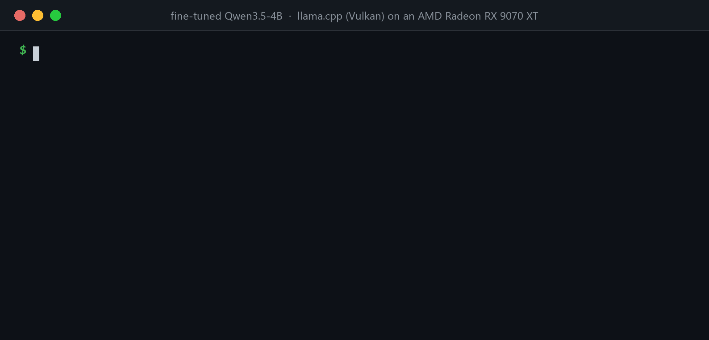

# FilingFigures

**A 4-billion-parameter model, fine-tuned for under $1, reads SEC 10-K filings and pulls out six key financial figures as accurately as a model with ~100× more parameters, at 1/400th of the frontier model's cost.**

Every answer is checked against the XBRL data each company filed with the SEC, so accuracy is measured, not eyeballed.

- **98.8%** of figures right on companies the model never saw in training (95.4% before fine-tuning).
- **Ties Qwen3.5-397B** (98.7%) and comes within 1.2 points of **Claude Opus 5.5** (100%).
- **$0.07 per 1,000 filings** served in 4-bit on one RTX 5090, vs $3.66 for Qwen3.5-397B and $29.84 for Opus.

**Part 2** makes it harder: 12 figures instead of 6, tested on mid-size companies from a year the model never saw, with reinforcement learning (GRPO) next to supervised fine-tuning. The fine-tuned 4B gets **99.0%** there and beats Qwen3.5-397B. GRPO reaches **98.2%** without ever seeing a correct answer, but doesn't beat supervised fine-tuning. [Read part 2](#part-2-12-figures-mid-cap-companies-and-grpo).

**Links:** [browse every answer](https://huggingface.co/spaces/kyryk/filing-figures) · [model](https://huggingface.co/kyryk/filing-figures-qwen3.5-4b-nvfp4) · [LoRA adapter](https://huggingface.co/kyryk/filing-figures-qwen3.5-4b-lora) · [dataset](https://huggingface.co/datasets/kyryk/filing-figures)
**Part 2:** [SFT adapter](https://huggingface.co/kyryk/filing-figures-v2-qwen3.5-4b-sft-lora) · [GRPO adapter](https://huggingface.co/kyryk/filing-figures-v2-qwen3.5-4b-grpo-lora) · [dataset](https://huggingface.co/datasets/kyryk/filing-figures-v2)



*A real run: the fine-tuned model reads NVIDIA's FY2026 10-K, a company and a year it never saw, and gets all six figures right in 3.7 s. Here it runs as an 8-bit GGUF with llama.cpp on an AMD Radeon RX 9070 XT.*

## Results

Test set: 207 filings from 36 companies, none of them seen during training or tuning. 1,186 figures scored. The test set was run once, at the end.

| Model | Figures right | Filings with all 6 right | $ per 1,000 filings |
|---|---|---|---|
| Rules (regex, no model) | 92.1% | 62% | $0 |
| Qwen3.5-4B, no fine-tuning | 95.4% | 83% | $0.11 |
| Qwen3.5-4B, fine-tuned | 98.4% | 91% | $0.10 |
| **Qwen3.5-4B, fine-tuned, 4-bit (NVFP4)** | **98.8%** | **93%** | **$0.07** |
| Qwen3.5-397B (open model, ~100× bigger) | 98.7% | 93% | $3.66 |
| Claude Opus 5.5 (frontier) | 100.0% | 100% | $29.84 |

How sure are these numbers? Gaps between models, with 95% intervals from resampling companies:

| Comparison | Gap (points) |
|---|---|
| Fine-tuned 4-bit vs no fine-tuning | **+3.4** [+0.5, +7.8] |
| Fine-tuned 4-bit vs Qwen3.5-397B | +0.2 [−1.0, +1.0] (a tie) |
| Claude Opus 5.5 vs fine-tuned 4-bit | **+1.2** [+0.1, +2.6] |

Costs:
- **The 4B models:** GPU rental ($1.19/h) divided by measured throughput.
- **API models:** what the test run actually cost on OpenRouter.

## The task

The model reads a 10-K's cover page and its three main financial statements (income statement, balance sheet, cash flow statement), turned into plain-text tables of about 4,500 tokens. It returns JSON with six figures:

| Field | What it is |
|---|---|
| `revenue` | Total revenue or net sales for the year |
| `net_income` | Net income attributable to the company |
| `eps_diluted` | Diluted earnings per share |
| `total_assets` | Total assets at year end |
| `shares_outstanding` | Common shares outstanding, from the cover page |
| `operating_cash_flow` | Net cash from operating activities |

Each figure comes with its full value in dollars or shares, the scale the filing prints it in, the period end date and the fiscal year. The fine-tuned model's real answer for Starbucks' FY2024 10-K (all six right):

```json
{
  "revenue":             {"value": 36176200000, "scale": "millions", "period_end": "2024-09-29", "fiscal_year": 2024},
  "net_income":          {"value": 3760900000,  "scale": "millions", "period_end": "2024-09-29", "fiscal_year": 2024},
  "eps_diluted":         {"value": 3.31,        "scale": "units",    "period_end": "2024-09-29", "fiscal_year": 2024},
  "total_assets":        {"value": 31339300000, "scale": "millions", "period_end": "2024-09-29", "fiscal_year": 2024},
  "shares_outstanding":  {"value": 1133800000,  "scale": "millions", "period_end": "2024-11-13", "fiscal_year": 2024},
  "operating_cash_flow": {"value": 6095600000,  "scale": "millions", "period_end": "2024-09-29", "fiscal_year": 2024}
}
```

**A figure counts as right** when its value is within 0.5% (EPS: within $0.005) **and** its period end date is exact. Turning "36,176.2 (in millions)" into 36,176,200,000 is part of the task. That's where the base models slip most: an extra zero, or a forgotten "in millions".

## How it was built

1. **Data.** 250 S&P 500 companies (banks and insurers left out, since they have no single revenue line), with their 10-K filings for fiscal years 2019–2024: **1,361 filings from 236 companies**. They're split **by company** (163 train, 37 validation, 36 test), because a 10-K repeats last year's numbers and a split by filing would leak answers.
2. **Answer key.** Each figure comes from the company's own XBRL data, matched to the exact filing and period. The printed scale ("in millions") comes from the filing's inline XBRL.
   - I checked 100 test filings (600 figures) by hand and found **1 error**: a revenue the key had left unscored.
   - In the random part of that check, 1 of 240 figures was wrong, so the key's error rate is about 0.4% (under 2% with 95% confidence).
3. **Prompt.** Tuned in 4 rounds on validation filings, then frozen and used unchanged for every model.
4. **Base model.** Four small models compared on all 214 validation filings (below).
5. **Fine-tuning, quantization, serving.**
   - LoRA fine-tuning with Unsloth.
   - 4-bit and 8-bit quantization with llm-compressor.
   - Serving and speed tests with vLLM on a rented RTX 5090.

## Picking the base model

Zero-shot (no fine-tuning) on 214 validation filings, 1,237 figures:

| Model | Figures right | Main mistake |
|---|---|---|
| **Qwen3.5-4B** | **96.6%** | Off by 10× when writing out the number (29 of 42 misses) |
| Qwen3.5-9B | 95.3% | Forgets to apply "in millions" (49 of 58 misses) |
| Gemma 4 E4B | 91.9% | Off by 10× or 100× (80 of 100 misses) |
| Qwen3-8B | 65.6% | Off by 10×, e.g. 5,794 million → 57.9 billion (360 of 425 misses) |

The rule: take the best model, but if a smaller one is within the best one's 95% interval, take the smaller one. Here the smallest model also had the highest score, so Qwen3.5-4B won outright.

## Fine-tuning

- **Method:** bf16 LoRA. Unsloth advises against 4-bit QLoRA training for Qwen3.5.
  - Rank 16, α 32, learning rate 2e-4.
  - 16 filings per step, 3 epochs.
- **What it learns from:** the 940 training filings and their answer-key JSON. Loss is computed on the answer only. Blank fields (e.g. several share classes) aren't trained on, because blank means "not scored", not "absent".
- **Time and cost:** 44 minutes on an RTX 5090 (about $0.90), using 10.4 GiB of GPU memory.
- **Which checkpoint:** all six checkpoints (every half epoch) scored **100%** on validation, so the earliest one was kept, **after half an epoch**. The model learns the conventions almost immediately. Validation was too easy to tell the checkpoints apart, so the test set gives the real number.

## Serving: 4-bit and speed

Fine-tuned model on validation, served by vLLM on one RTX 5090:

| Format | Figures right | Weights | Filings / second | $ per 1,000 filings |
|---|---|---|---|---|
| bf16 (16-bit) | 100.0% | 7.9 GiB | 3.3 | $0.100 |
| FP8 | 99.9% | 5.5 GiB | 4.2 | $0.079 |
| W4A16 (4-bit weights) | 99.8% | 4.3 GiB | 3.6 | $0.093 |
| **NVFP4 (4-bit, Blackwell GPUs)** | 99.8% | 4.4 GiB | **4.6** | **$0.073** |

- **4-bit costs almost nothing in accuracy:** 2 of 1,237 figures. On test, NVFP4 even scored slightly higher than bf16 (98.8% vs 98.4%, within noise).
- **The job is mostly reading.** Each filing is ~5,000 tokens in and ~300 out, so throughput is limited by processing the input. FP8 and NVFP4 speed that up; W4A16 mainly shrinks memory, so it's fastest for one filing at a time (1.5 s) but not under load.
- **32 filings at a time gave the most throughput** of the loads tried (1, 8, 32, 256). At 256, throughput drops slightly and the median filing waits about a minute.

## Where the fine-tuned model still fails

Its 14 wrong figures on test (of 1,186) come from just **4 companies**, and almost all are judgment calls about which line counts:
- **Chevron, revenue (5):** the model reported "Sales and other operating revenues"; the key uses "Total revenues and other income".
- **Becton Dickinson and Alexandria Real Estate, net income (8):** the model reported net income *left for common shareholders* (after preferred dividends); the key uses net income.
- **Chipotle, shares outstanding (1):** a share count printed "in thousands" taken at face value.

## Other findings

- **Fine-tuning removed the off-by-10× slips.** They were 24 of the base model's 54 misses on test; the fine-tuned model made none.
- **"Thinking" mode isn't worth it here.** With reasoning on, the base 4B got 1,182 of the 1,183 figures it answered right. But it wrote about 11× more tokens (median 4,400), took a median of 2 minutes per filing, and gave no usable answer on 10 of 214 filings. Fine-tuning reached that accuracy without the cost.
- **Forcing JSON with a schema changed nothing.** Without one, every non-thinking model already returned valid JSON on all 214 validation filings.
- **Fine-tuning shortened the answers** from about 400 to 315 tokens, and the model ran 10% faster.
- **The rules baseline is strong (92%)** but gets all six right on only 62% of filings. Most of the value is in the hard cases.

## Limitations

- **36 test companies is not many.** Errors cluster by company (see above), so intervals are a few points wide.
- **Some figures are left unscored:** companies with several share classes have no single share count, and a figure the input builder didn't capture isn't scored. Filings with more than two such figures were dropped (7 of 214 test filings).
- **Definitions are conventions.** Revenue with or without "other income", net income before or after preferred dividends: the key follows each company's primary XBRL tags.
- **Data coverage:** non-financial S&P 500 companies, 10-Ks from 2019–2024 only.
- **The large API models may have seen these filings in training.** That wasn't tested.

## Part 2: 12 figures, mid-cap companies and GRPO

Part 1 left little headroom, so part 2 makes the task harder and asks a different question: **does reinforcement learning generalize better than supervised fine-tuning** to companies unlike the ones it trained on?

**What changed:**
- **12 figures per filing.** New: basic EPS, cash, stockholders' equity, prior-year revenue, capital expenditures, and free cash flow (operating cash flow minus capex, which the model has to compute).
- **A second test set, out of distribution:** FY2025 10-Ks from S&P MidCap 400 companies. They're smaller companies, from a year after all the training data. Split by company into mid-cap validation (75 filings) and mid-cap test (119).
- **Training, validation and S&P 500 test** use part 1's companies (934, 214 and 207 filings).
- **The answer key was checked by hand again:** 50 mid-cap test filings, 550 figures. No value was wrong. 10 figures the key had left blank were filled in, mostly where a company used an XBRL tag the labeler doesn't know.

**Two ways to train the same Qwen3.5-4B:**
- **SFT** learns from the answer key's JSON, with part 1's recipe (LoRA rank 16, 3 epochs, 25 minutes on an H100).
- **GRPO** never sees an answer. For each filing it writes 8 answers, scores each one against the key with the test's own rule (the share of figures right), and learns from how the 8 compare. LoRA rank 32, learning rate 1e-5, 8 filings per step, no KL penalty; 72 steps, 2.4 hours on an H100.

Each picked its checkpoint on both validation sets together. Each test set was run once.

### Results

Mid-cap test: 119 filings from 119 companies, 1,372 figures.

| Model | Figures right | Filings with all 12 right |
|---|---|---|
| Qwen3.5-4B, no fine-tuning | 86.2% | 55% |
| Qwen3.5-4B, GRPO | 98.2% | 85% |
| Qwen3.5-397B | 98.3% | 88% |
| **Qwen3.5-4B, SFT** | **99.0%** | **92%** |
| Claude Opus 5.5 | 99.3% | 96% |

On the S&P 500 test set (207 filings, 2,324 figures): 95.4% before fine-tuning, 98.4% with GRPO, 98.8% with SFT.

| Comparison, with 95% intervals | Gap (points) |
|---|---|
| SFT vs no fine-tuning, mid-cap | **+12.8** [+8.7, +17.2] |
| GRPO vs SFT, mid-cap | **−0.8** [−1.5, −0.1] |
| GRPO vs SFT, S&P 500 | **−0.4** [−0.9, −0.04] |
| SFT vs Qwen3.5-397B, mid-cap | **+0.7** [+0.1, +1.3] |
| Claude Opus 5.5 vs SFT, mid-cap | **+0.4** [+0.1, +0.8] |

### What I found

- **GRPO didn't generalize better.** It trails SFT on both test sets. Still, it got 94% of SFT's mid-cap gain from a reward alone, and it ties Qwen3.5-397B (−0.1 [−0.7, +0.4]), a model about 100× its size.
- **Mid-caps are where fine-tuning pays.** The base model falls from 95.4% to 86.2% on them, mostly by writing numbers 10× too big or too small (142 of its 190 misses). The fine-tuned models made that mistake once between them.
- **GRPO ran out of signal.** It only learns from filings where its 8 answers disagree. That was 78% of filings in the first 12 steps and 5% by the end, as the model grew sure of itself. The best checkpoint came at step 48, and nothing improved after it.
- **GRPO falls short on conventions,** like which line counts as capex. On mid-caps it trails SFT on prior-year revenue (95.8% vs 98.3%), capex (94.3% vs 96.2%) and free cash flow (93.3% vs 97.1%). SFT is shown the convention 934 times; GRPO has to stumble on it and get rewarded.

Getting GRPO to run with vLLM on Qwen3.5 (TRL 1.17.1, vLLM sharing the GPU) took two fixes:
- **Weight sync.** TRL sends the LoRA weights to vLLM by merging them into the bf16 base weights and unmerging after, which slowly changes the frozen base ([TRL #7427](https://github.com/huggingface/trl/pull/7427), open). I replaced it with a merge computed in fp32 that never touches the base. A test checks the base stays bit-identical.
- **Weight names.** Training Qwen3.5's text-only class gives names vLLM rejects ([vLLM #36275](https://github.com/vllm-project/vllm/issues/36275)), so training uses the vision-language class and vLLM runs language-only.

A short check run gated the overnight run: vLLM's and the trainer's log-probabilities agreed to 0.0005 on average (the gate was 0.1).

**Not tried, to keep costs down:** GRPO starting from the SFT model, and a GRPO run with more answers per filing or a higher temperature to keep the answers disagreeing longer.

## Cost of the whole project

| Item | Cost |
|---|---|
| Part 1, GPU rental (RTX 5090, Runpod): setup checks, bake-off, training, quantization, speed tests, test run | ~$4.50 |
| Part 1, OpenRouter: prompt tuning and Qwen3.5-397B | ~$1.20 |
| Part 1, OpenRouter: Claude Opus 5.5 on the test set | $6.18 |
| Part 2, GPU rental: SFT, GRPO and checkpoint scoring on an H100; the test run on an RTX 5090 | ~$21 |
| Part 2, OpenRouter: prompt tuning, Qwen3.5-397B and Claude Opus 5.5 on the mid-cap test | $5.70 |
| **Total** | **~$39** |

## Try it on any 10-K

`figures extract` fetches a filing from SEC EDGAR, builds the same input as the dataset, asks a model and scores each figure against the company's XBRL. Serve the fine-tuned model with vLLM (NVFP4 needs a Blackwell GPU, e.g. an RTX 5090):

```bash
vllm serve kyryk/filing-figures-qwen3.5-4b-nvfp4 --served-model-name filing-figures   --max-model-len 12288 --language-model-only --default-chat-template-kwargs '{"enable_thinking": false}'
uv run figures extract --ticker SBUX --year 2025 --endpoint http://localhost:8000/v1 --model filing-figures
```

Any OpenAI-compatible endpoint works. The demo at the top merges the LoRA adapter into Qwen3.5-4B (`merge.py`), converts it to an 8-bit GGUF with llama.cpp's `convert_hf_to_gguf.py`, and serves it with `llama-server --reasoning off` on an AMD GPU. Here it runs on Starbucks' FY2025 10-K, filed after the dataset was built, with Qwen3.5-9B through OpenRouter:

```
$ uv run figures extract --ticker SBUX --year 2025 --endpoint openrouter --model qwen/qwen3.5-9b
SBUX FY2025 10-K (accession 0000829224-25-000114, filed 2025-11-14): 15,055 characters of statements
qwen/qwen3.5-9b: answered in 11.3 s

field                         model  period end  XBRL (answer key)  period end
revenue              37,184,400,000  2025-09-28     37,184,400,000  2025-09-28  right
net_income            1,856,400,000  2025-09-28      1,856,400,000  2025-09-28  right
eps_diluted                    1.63  2025-09-28               1.63  2025-09-28  right
total_assets         32,019,700,000  2025-09-28     32,019,700,000  2025-09-28  right
shares_outstanding    1,137,100,000  2025-11-07      1,137,100,000  2025-11-07  right
operating_cash_flow   4,747,500,000  2025-09-28      4,747,500,000  2025-09-28  right

6/6 right
```

## Run it yourself

Needs [uv](https://docs.astral.sh/uv/) and Python 3.12. Copy `.env.example` to `.env` and fill in `SEC_USER_AGENT` (your name and email, which the SEC requires), `OPENROUTER_API_KEY` and `HF_TOKEN`.

```bash
uv sync

# Build the dataset (downloads from SEC EDGAR, at most 8 requests per second)
uv run figures universe
uv run figures split
uv run figures download
uv run figures build
uv run figures export

# Score models on validation filings (the test split needs --final and is logged)
uv run figures predict --endpoint rules --split valid
uv run figures score --run rules --split valid
uv run figures predict --endpoint openrouter --model qwen/qwen3.5-397b-a17b --reasoning off --run q397b --split valid --sample 20
uv run figures score --run q397b --split valid --sample 20

# Check the answer key by hand (a local web page)
uv run figures review

# Build the results viewer's data (space/) from the test predictions
uv run figures space

# Part 2: add the mid-cap companies, then build the 12-figure task
uv run figures ood-universe
uv run figures download
uv run figures build --task v2
uv run figures export --task v2
uv run figures review --task v2
```

The GPU stages run on a rented Linux GPU with CUDA 13 (an RTX 5090 here). Each stage uploads its results to a Hugging Face repo, then stops the pod:

```bash
# From your machine: send only the HF token, then set up the pod
grep '^HF_TOKEN=' .env | ssh -p <PORT> root@<IP> 'umask 077; mkdir -p /workspace; cat > /workspace/.env'
ssh -p <PORT> root@<IP> 'curl -fsSL https://raw.githubusercontent.com/nathankyryk/filing-figures/master/scripts/setup_pod.sh | bash'

# On the pod, in /workspace/filing-figures
bash scripts/run_gpu_jobs.sh check                                # ~50 min: every step once on tiny inputs
GPU_PRICE=1.19 bash scripts/run_gpu_jobs.sh all                   # ~3 h: bake-off, training, quantization, speed
HANDCHECK_DONE=1 QUANT=nvfp4 bash scripts/run_gpu_jobs.sh test    # ~20 min: the one test run

# Part 2 (set the pod up with TASK=v2 ENVS="train serve rl" in front of `bash`)
TASK=v2 bash scripts/run_gpu_jobs.sh check                          # tiny SFT and GRPO runs, go/no-go gates
CHAIN="sft2 grpo" GRPO_STEPS=72 bash scripts/run_gpu_jobs.sh chain  # ~4 h on an H100
HANDCHECK_DONE=1 bash scripts/run_gpu_jobs.sh test2                 # ~25 min: the one test run
```

## Code

| Path | What's there |
|---|---|
| `src/filing_figures/edgar.py`, `universe.py` | SEC downloads (rate-limited, cached) and the company and filing list |
| `labels.py`, `ixbrl.py` | The answer key from XBRL, and the printed scale from inline XBRL |
| `inputs.py`, `dataset.py` | Finding the statements, tables to text, splits |
| `prompts.py`, `schema.py`, `client.py` | The prompt, the output format, one client for vLLM and OpenRouter |
| `evaluate.py`, `rules.py`, `review.py` | Scoring, error types and confidence intervals; the rules baseline; the hand-check page |
| `sft.py`, `train.py`, `merge.py` | Training examples, LoRA training, merging the adapter into the model |
| `quantize.py`, `vllm_server.py`, `bench.py` | 4-bit and 8-bit versions, serving, speed tests |
| `extract.py`, `space.py` | `figures extract` (any 10-K, any model); the results viewer's data |
| `reward.py`, `rl.py`, `check_report.py` | Part 2: the reward and the filter, GRPO training with vLLM, the go/no-go check |
| `scripts/` | Pod setup and the GPU stages |
| `space/` | The results viewer (a static Hugging Face Space) |
| `hf/` | The Hugging Face dataset and model cards |
| `labels/handcheck.csv`, `handcheck_v2.csv` | The hand-check verdicts (part 1, part 2) |

## License

- **Code:** MIT.
- **Filings:** public data from SEC EDGAR.
- **Base model:** Qwen3.5-4B is Apache-2.0.
